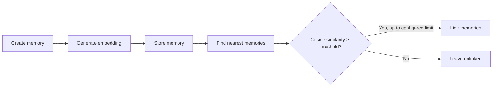

# Forgetful Search Functionality

This section details Forgetful's search functionality and associated configuration.

## Auto-Linking Pipeline

When a new memory is created, Forgetful automatically builds knowledge graph connections:

**How it works:**

1. **Encode** - Title, content, context, keywords, and tags are combined into a vector embedding
2. **Store** - The embedding is stored in the Forgetful database alongside the memory
3. **Similarity Search** - Existing memories are searched for semantic similarity
4. **Threshold** - Only matches with cosine similarity of at least 0.7 are kept by default
5. **Auto-Link** - Up to `MEMORY_NUM_AUTO_LINK` qualifying memories are linked (bidirectional)

This builds a knowledge graph where related concepts connect without manual intervention.

Set `MEMORY_SIMILARITY_THRESHOLD` to adjust the cutoff. Auto-linking does not use
cross-encoder reranking.

## Query Search Pipeline

`query_memory` searches by vector similarity. When reranking is enabled and more
than `k` candidates are returned, a cross-encoder reranks them using `query` and
`query_context`. That dense-only path is the default.

## Hybrid search (opt-in)

Set `HYBRID_SEARCH_ENABLED=true` to add a keyword leg and fuse it with the dense
ranking. The default is `false`. With the flag off, search behaviour and payloads
are unchanged: each `MemoryScore` still has `memory_id`, `similarity`, and
`rerank_score` (`null` when reranking did not run). `keyword_rank` and
`fusion_score` are omitted from the serialized score.

When the flag is on, each query:

1. Retrieves `max(k, DENSE_SEARCH_CANDIDATES)` dense hits (default 20).
2. Retrieves `max(k, SPARSE_SEARCH_CANDIDATES)` keyword hits (default 20).
3. Fuses the two ranked id lists with Reciprocal Rank Fusion:
   `score = Σ 1/(RRF_K + rank)` per leg, default `RRF_K=60`.
4. Breaks equal RRF scores on dense rank, except when the query looks like an
   identifier (`#123`, a ticket key such as `ABC-12`, or a single token with a
   code-like mark), in which case the keyword rank wins.
5. Truncates the fused list to `DENSE_SEARCH_CANDIDATES` when reranking is on,
   otherwise to `k`, fills cosine similarity for that pool, and (if reranking is
   on and the pool is larger than `k`) runs the same cross-encoder as dense-only
   search. `query_context` still enriches the rerank query only.

A keyword-leg database error is logged as a warning; search continues with the
dense ranking only.

### Keyword backends

- **SQLite:** FTS5 external-content table `memories_fts` over title, content,
  context, keywords, and tags (`unicode61` tokenizer), ranked by BM25. Created
  during `init_db` with insert/update/delete triggers. If the table or a trigger
  was missing, the index is rebuilt from `memories`.
- **PostgreSQL:** `search_tsv tsvector` on `memories`, maintained by trigger
  `memories_search_tsv_trg` with `to_tsvector('simple', ...)` over the same
  fields, GIN index `ix_memories_search_tsv`, ranked by `ts_rank_cd`. Added by
  Alembic revision `20261103_memory_search_tsv`
  (`alembic/versions/20261103_add_memory_search_tsv.py`). The migration is a
  no-op when `DATABASE` is not `Postgres`.

With the flag on, retained scores may include `keyword_rank` (1-based rank in
the keyword leg; omitted when that memory was not a keyword hit) and
`fusion_score`.

Settings: `HYBRID_SEARCH_ENABLED`, `SPARSE_SEARCH_CANDIDATES`, and `RRF_K` in
[configuration.md](configuration.md#hybrid_search_enabled).

A synthetic comparison of vector vs hybrid is in
[benchmarks/retrieval/README.md](../benchmarks/retrieval/README.md). On the
committed 300-memory corpus, `--quick` MRR@10 was 0.360 vector / 0.749 hybrid
overall (identifier 0.229 / 0.756); overall R@10 was 0.480 / 0.947. Reproduce
with `uv run python benchmarks/retrieval/run_eval.py --quick` (about a minute;
skips the reranker) or without `--quick` for the four-config run including the
cross-encoder (about 80 minutes on CPU).

---

## Embedding Providers

### [FastEmbed](https://github.com/qdrant/fastembed)
For local embeddings and re-ranking we support the use of the excellent embedding solution developed by Qdrant. 

### [Google](https://ai.google.dev/gemini-api/docs/embeddings)
We also support Google Embedding models available via the Gemini API

### [Azure](https://learn.microsoft.com/en-us/azure/ai-foundry/openai/tutorials/embeddings?view=foundry-classic&tabs=command-line)
Support for the Azure Foundry OpenAI embeddings is now added as well. 
## Configuration
The following configuration options are available for search
